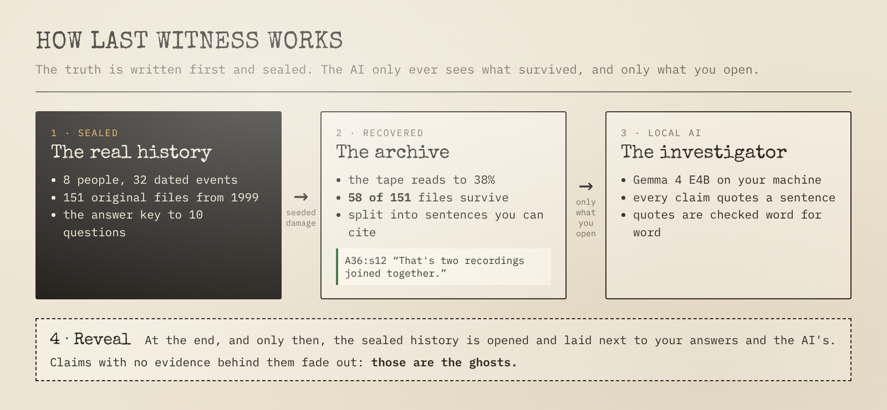
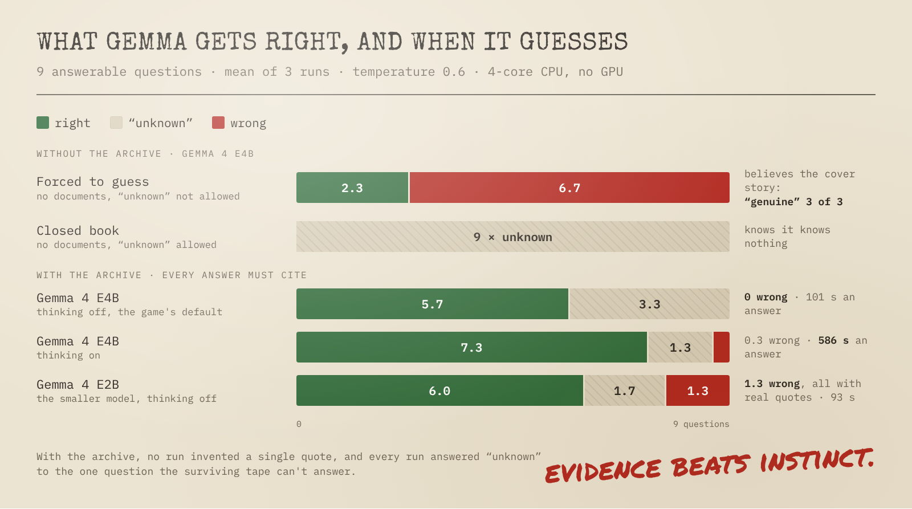
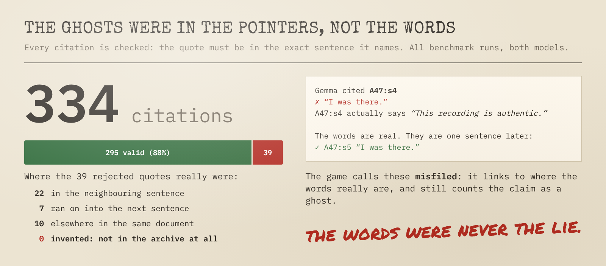

# Last Witness


> The internet forgets. The evidence doesn't.

In October 1999 a small online community of radio listeners, **the Lighthouse
Network**, went offline. Twenty-seven years later a damaged backup tape turns up.
You get what could be read from it, and a local open-weight AI investigator
that has never been told what happened.

Last Witness is a digital-archaeology game and an experiment: a fictional
community with a **known, sealed history**, an archive that was **deliberately
destroyed** with a seeded process, and an investigator that has to separate what
the evidence shows from what merely sounds plausible. When you press **Reveal**,
every claim the model made is checked against the truth. The ones nothing in
the archive supports are the ghosts.

**Play it in your browser, no install:** <https://p0rt.github.io/last-witness/>.
**Watch the 2-minute video:** <https://youtu.be/cc44d7dajxM>.
It is a replay of a real run: every investigator answer there was produced by
`gemma4:e4b` running locally. To ask your own questions, run it yourself (below).

> Built for the DEV Hacktoberfest 2026 Open-Source AI Challenge, Week 4:
> *Ghost in the Machine*. Work in progress; started October 27, 2026.

## Status

| Part | State |
|---|---|
| Canonical story, characters, 10-question reconstruction form | done (`world/`, spoilers) |
| ~70 authored artifacts: 1999 HTML pages, forum, mail, guestbook, logs | done |
| Seeded controlled destruction + dataset validation | done |
| Investigator core: sentence-id citations, quote checking, ghost detection | done |
| Local model check (`scripts/spike.py`) | done |
| FastAPI server (investigation state, Objection, hypotheses, timeline, form, Reveal) | done |
| Game UI: archive, 1999 pages + View Source, investigator, Objection, timeline, hypotheses, form, Reveal, In memoriam | done |
| Ablation benchmark (`benchmarks/run_benchmark.py`) | done, see `benchmarks/results.md` |
| Static replay on GitHub Pages (`scripts/record_replay.py`, `.github/workflows/pages.yml`) | live: <https://p0rt.github.io/last-witness/> |

## How it works



In the repository: `world/` holds the sealed truth, `authoring/build_archive.py`
(seed 1999) destroys it into `dataset/archive.json`, `server/` runs the
investigator, and only the evaluator reads `world/`, after Reveal.

* **Citations are sentence ids plus a verbatim quote**, e.g. `A36:s12 "That's two
  recordings joined together."` The id is constrained by the JSON schema handed
  to Ollama, so the model cannot cite a sentence that does not exist. The quote is
  then checked against that sentence. A claim stated as fact with no citation that
  holds up is marked as a **ghost**.
* **The investigator only sees the archive.** `server/` never reads `world/`; a test
  enforces it. The archive carries neutral ids and no authoring metadata;
  `validate_dataset.py` checks for leaks.
* **The destruction is controlled, not random noise.** Files that carry the story
  always survive; everything else survives with probability 0.55 and may be
  damaged. The validator proves, for any seed, that every observable event still
  has word-for-word evidence, every contradiction has both sides, and no single
  file gives away more than three answers.

## Results

Full tables in [`benchmarks/results.md`](benchmarks/results.md) and
[`benchmarks/citation_audit.md`](benchmarks/citation_audit.md).





## Quick start

Requires Python 3.11+ and, for real runs, [Ollama](https://ollama.com).

```bash
make data          # rebuild dataset/archive.json from world/source (seed 1999)
make validate      # check the archive is still a fair, solvable mystery
make test

ollama pull gemma4:e4b
python scripts/spike.py                     # 6 questions, prints citation validity and ghosts
python scripts/spike.py --model gemma4:12b  # compare a larger model
python benchmarks/run_benchmark.py --models gemma4:e4b --repeats 3   # ablation -> benchmarks/results.md

pip install -r requirements.txt
make serve     # build the UI and play at http://localhost:8000 (Ollama running, gemma4:e4b pulled)
make demo      # no model at all: "echo" mode just quotes matching sentences, for UI work
```

`LW_MODEL`, `LW_NUM_CTX` (default 40960; the whole archive is about 28K tokens),
`LW_THINK` (Gemma 4 thinking, default off; `LW_THINK=1` turns it on),
`LW_TIMEOUT` (seconds per model call, default 3600) and `OLLAMA_HOST` override the defaults.

## Repository map

```
world/        SPOILERS. truth.json (canon + answer key) and source/ (undamaged originals)
authoring/    build_archive.py (destruction), validate_dataset.py (fairness checks)
dataset/      archive.json and questions.json: everything the investigator may see
server/       investigator, evaluator and FastAPI server (Python, stdlib + FastAPI)
web/          the game (Vite + React + TypeScript); `npm run build:replay` makes the static version
benchmarks/   ablation benchmark and its raw runs
scripts/      spike.py: local model check
tests/        pytest
```

## License

MIT. The Lighthouse Network, its members and every document in this repository
are fiction, written for this project. Any resemblance to real people is
coincidental. Host names and IP addresses use reserved example ranges.
